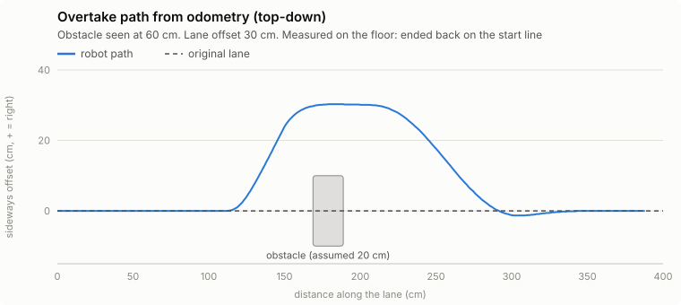
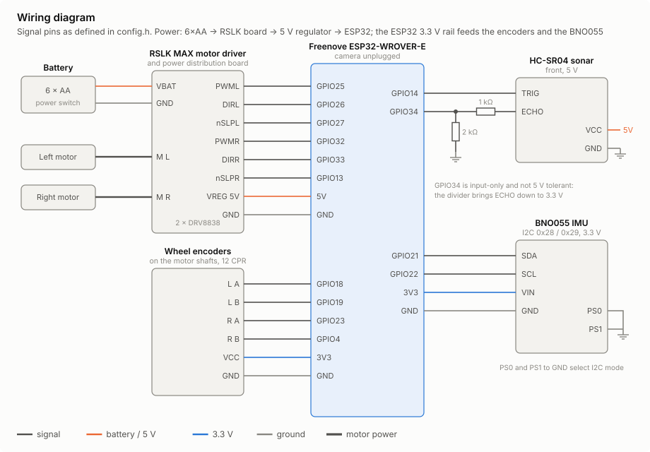
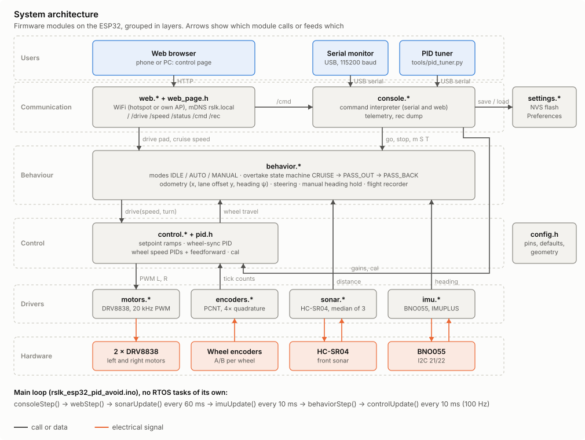
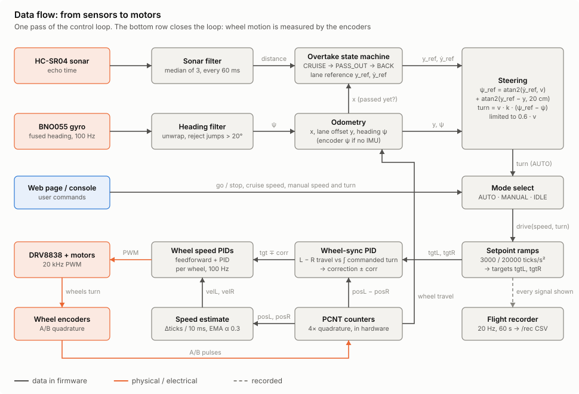
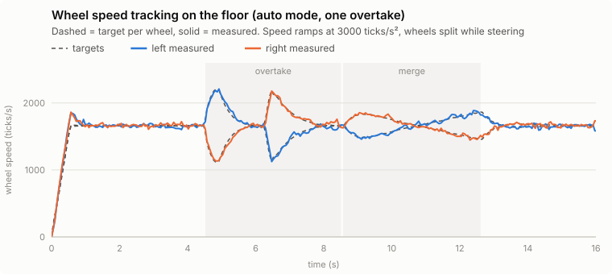
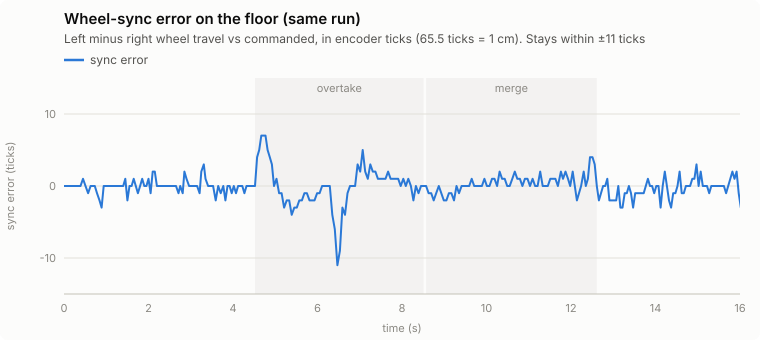
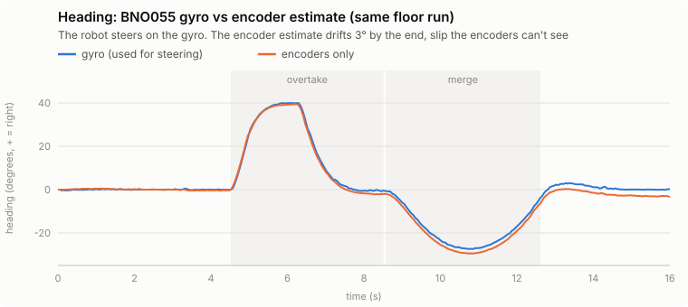
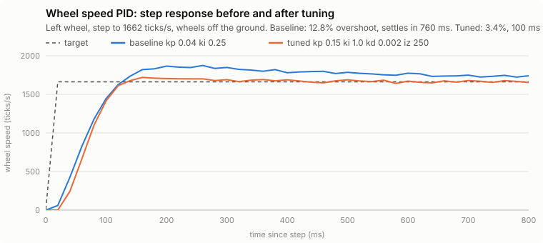
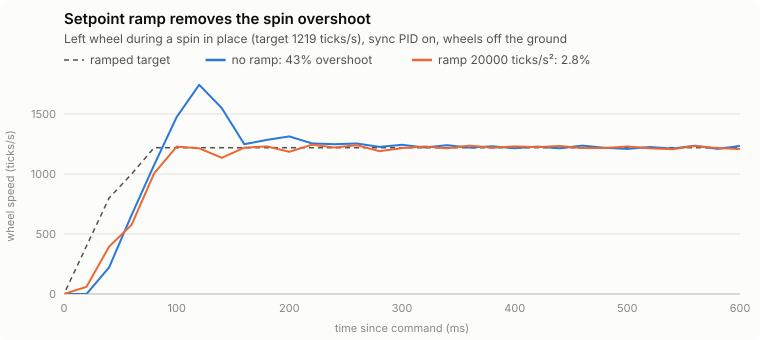

# RSLK ESP32: PID drive and car-style obstacle overtaking

**Authors:** Aman Mishra, Middlesex University Dubai

## Introduction

This is firmware for a **TI-RSLK MAX** robot chassis driven by a **Freenove ESP32-WROVER-E** board in place of the kit's
original MSP432 LaunchPad. The robot drives in a straight lane, sees obstacles with an ultrasonic sensor and **overtakes
them like a car**: it pulls out, passes, and merges back onto its original line, without stopping or reversing.

- **Encoders counted in hardware:** the ESP32 PCNT peripheral counts every encoder edge (4× quadrature), with no interrupts.
- **Closed-loop wheel speed:** each wheel has a speed PID with feedforward.
- **Driving straight:** a wheel-sync PID keeps the robot straight and makes it turn by exactly the commanded amount.
- **Heading:** an optional BNO055 gyro supplies the heading, so wheel slip doesn't steer it off course.
- **Control:** use the **USB serial console** or a **web page served by the ESP32**, for example over a phone hotspot.
- **Saved settings:** gains, calibration and the cruise speed are stored in flash and survive power cycles.
- **Flight recorder:** logs the last 60 s of driving, downloadable as CSV.

<p align="center">
  <br>
  <em>Figure 1. Top-down path of one autonomous overtake, from the robot's own odometry (x_cm, y_cm and dist_cm columns
  of <a href="logs/rslk_run_2.csv">logs/rslk_run_2.csv</a>, flight recorder at 20 Hz, floor run on 25 Nov 2026).
  A tape line on the floor confirmed that the robot ended back on its start line.</em>
</p>

## Contents

- [Introduction](#introduction)
- [Requirements](#requirements)
  - [Hardware](#hardware)
  - [Software](#software)
- [Definitions](#definitions)
- [Electrical circuit diagram](#electrical-circuit-diagram)
- [Pin connections](#pin-connections)
- [System architecture](#system-architecture)
- [Data flow](#data-flow)
- [Building on Arduino IDE](#building-on-arduino-ide)
  - [Building from the command line](#building-from-the-command-line)
- [First run](#first-run)
- [Web control](#web-control)
- [Auto mode (overtaking)](#auto-mode-overtaking)
- [Speed matching](#speed-matching)
- [Left-right error elimination](#left-right-error-elimination)
- [PID tuning](#pid-tuning)
  - [PID tuner tool](#pid-tuner-tool)
- [Tuning guide](#tuning-guide)
- [Kalman filtering of IMU and encoders](#kalman-filtering-of-imu-and-encoders)
- [Console commands](#console-commands)
- [Code layout](#code-layout)
- [Regenerating the figures](#regenerating-the-figures)
- [FAQ](#faq)
- [Acknowledgements](#acknowledgements)

## Requirements

### Hardware

| Item | Qty | Notes |
|---|---|---|
| TI-RSLK MAX chassis kit | 1 | Pololu Romi chassis, two motors with 120:1 gearboxes, 70 mm wheels, wheel encoders (12 counts per motor turn), and the motor driver and power distribution board (two DRV8838 drivers and a 5 V regulator) |
| Freenove ESP32-WROVER-E (CAM) board | 1 | The camera must be unplugged, because its pins are reused |
| HC-SR04 ultrasonic sensor | 1 | Mounted at the front, facing forward |
| 1 kΩ and 2 kΩ resistors | 1 each | Voltage divider for the HC-SR04 ECHO line. Not needed with the 3.3 V HC-SR04P |
| BNO055 IMU breakout | 1 | Optional, but needed for an accurate overtake. With a bare GY-BNO055 board, PS0 and PS1 must be tied to GND |
| AA batteries | 6 | NiMH rechargeables recommended |
| Jumper wires, USB cable | – | USB is only needed for flashing and the serial console |

The finished robot weighs about 390 g.

### Software

| Item | Version | Notes |
|---|---|---|
| Arduino IDE | 2.x | Or `arduino-cli` (see [Building from the command line](#building-from-the-command-line)) |
| ESP32 board package (Espressif Systems) | 3.x | Tested with 3.3.12 |
| Adafruit BNO055 library | latest | From the Library Manager, with its dependencies **Adafruit Unified Sensor** and **Adafruit BusIO** |
| `WiFi`, `WebServer`, `ESPmDNS`, `Preferences` | – | Come with the ESP32 board package |
| Python 3 with `pyserial` | 3.8+ | Optional: only for the [PID tuner tool](#pid-tuner-tool) and [regenerating the figures](#regenerating-the-figures) |
| A web browser | – | Phone or PC, on the same WiFi network as the robot |

## Definitions

| Term | Meaning |
|---|---|
| **Tick** | One counted encoder edge. One wheel turn is 1440 ticks (from the motor spec, see the [FAQ](#how-was-1440-ticks-per-wheel-turn-obtained)), and 1 cm of travel is 65.5 ticks (`TICKS_PER_CM`) |
| **Quadrature, 4× counting** | Each encoder has two outputs, A and B, that are a quarter cycle apart. Counting both edges of both outputs gives four counts per cycle, and the order of the edges gives the direction |
| **PCNT** | The ESP32's pulse counter peripheral. It counts encoder edges in hardware, so no CPU time or interrupts are used |
| **Speed units: ticks/s** | Wheel speed in encoder ticks per second. `MAX_TPS` is the top speed at full power (about 2825 ticks/s, or 43 cm/s) |
| **Command units: −255…255** | Speed and turn commands are given on this scale, where 255 = `MAX_TPS`. A positive turn veers right |
| **PWM** | Pulse-width modulation: the motor power, from 0 to 255, at 20 kHz |
| **PID** | Proportional-integral-derivative controller. It sets an output from the error, the accumulated error and the error's rate of change, with gains kp, ki and kd |
| **Feedforward** | The PWM a wheel is expected to need for a given speed, applied straight away. The PID only corrects what's left |
| **Integral zone** | The integrator only accumulates while the error is below this value, which stops windup during acceleration |
| **Setpoint ramp** | The target speed changes at a limited rate (`ACCEL_TPS2`) rather than jumping, so starts and stops are smooth |
| **Low-pass filter (EMA)** | An exponential moving average that smooths the measured speed: `vel += VEL_ALPHA × (raw − vel)` |
| **Wheel sync / sync error** | The difference between left and right wheel travel, compared with what the commanded turn should have produced. Zero means the robot has turned exactly as commanded |
| **Heading (psi)** | The direction the robot points, relative to its direction at the start, in degrees. Positive = turned right |
| **Odometry** | Working out position from wheel travel and heading. Gives the distance along the lane (x) and the lane offset (y) |
| **Lane offset** | Sideways distance from the original line, in cm. Positive = right |
| **Cruise speed** | AUTO mode's driving speed, set by the web slider and saved to flash |
| **IMU / IMUPLUS** | Inertial measurement unit. IMUPLUS is the BNO055 mode that fuses the gyro and accelerometer on the chip, without the magnetometer |
| **NVS / Preferences** | The ESP32's non-volatile storage in flash, where settings are saved |
| **Flight recorder** | A RAM buffer of the last 60 s of driving data at 20 Hz, downloadable as CSV |

## Electrical circuit diagram

<p align="center">
  <br>
  <em>Figure 2. Wiring diagram. The signal pins come from <a href="config.h">config.h</a>. The power wiring is as built on this
  robot: the ESP32 runs from the RSLK board's 5 V regulator, and the ESP32's 3.3 V rail feeds the encoders and the BNO055.</em>
</p>

- **Power:** the six AA cells feed the RSLK board (VBAT). The board drives the motors from VBAT, and its 5 V regulator
  (VREG) powers the ESP32 through its 5V pin. Every module shares one ground.
- **Encoders on 3.3 V:** this keeps their outputs at a level the ESP32 can safely read.
- **HC-SR04 on 5 V:** its ECHO output is 5 V, but GPIO34 is input-only and **not 5 V tolerant**. The 1 kΩ / 2 kΩ divider
  scales ECHO to 5 × 2/3 = 3.3 V. Alternatively, use the 3.3 V HC-SR04P and leave the divider out.
- **BNO055 on 3.3 V:** with PS0 and PS1 tied to GND it starts in I2C mode. Without that, it doesn't answer on the I2C bus.
- **Unplug the camera:** the Freenove board's camera uses some of these GPIOs.

## Pin connections

All pins are defined in [`config.h`](config.h).

| Module | Module pin | ESP32 pin | Notes |
|---|---|---|---|
| RSLK board, left motor | PWML / DIRL / nSLPL | GPIO25 / GPIO26 / GPIO27 | DRV8838: speed (20 kHz PWM), direction, enable |
| RSLK board, right motor | PWMR / DIRR / nSLPR | GPIO32 / GPIO33 / GPIO13 | As above |
| RSLK board, power | VREG 5V / GND | 5V / GND | Powers the ESP32 |
| Left encoder | A / B | GPIO18 / GPIO19 | Counted in hardware by PCNT |
| Right encoder | A / B | GPIO23 / GPIO4 | Counted in hardware by PCNT |
| Encoders, power | VCC / GND | 3V3 / GND | |
| HC-SR04 | TRIG | GPIO14 | |
| HC-SR04 | ECHO | GPIO34 via 1 kΩ, with 2 kΩ to GND | Input-only pin, not 5 V tolerant |
| HC-SR04, power | VCC / GND | 5V / GND | |
| BNO055 | SDA / SCL | GPIO21 / GPIO22 | I2C at 100 kHz, address 0x28 or 0x29 (found automatically) |
| BNO055, power | VIN / GND | 3V3 / GND | |
| BNO055, mode | PS0 / PS1 | GND / GND | Selects I2C mode |

If a motor or encoder turns out to be reversed, don't rewire it: set `FLIP_MOTOR_L/R` in `config.h`, and `cal` detects
the encoder directions (see [First run](#first-run)).

## System architecture

The firmware is split into modules in layers. Each layer mostly calls the one below it. The behaviour layer also reads
the sonar and IMU drivers directly:

<p align="center">
  <br>
  <em>Figure 3. Firmware modules and how they connect. Drawn from the source: the module files listed in
  <a href="#code-layout">Code layout</a>, their headers, and <code>setup()</code> / <code>loop()</code> in
  <a href="rslk_esp32_pid_avoid.ino">rslk_esp32_pid_avoid.ino</a>.</em>
</p>

| Layer | Modules | Job |
|---|---|---|
| Communication | `web.*`, `web_page.h`, `console.*` | Take commands from the web page, the serial monitor or the PID tuner. Web commands typed in the command box run through the same console interpreter |
| Behaviour | `behavior.*` | Decide what the robot should do: the mode (IDLE, AUTO, MANUAL), the overtake state machine, odometry, steering, and the flight recorder. Its output is a speed and a turn |
| Control | `control.*`, `pid.h` | Turn the speed and turn into wheel targets and hold the wheels on them: setpoint ramps, wheel-sync PID, wheel speed PIDs with feedforward |
| Drivers | `motors.*`, `encoders.*`, `sonar.*`, `imu.*` | Talk to the hardware: PWM out, encoder counts, sonar distance, gyro heading |
| Alongside | `settings.*`, `config.h` | `config.h` holds the pins and defaults. `settings.*` saves and restores tuned values in flash |

Everything runs in the Arduino `loop()` on one core, with no tasks of its own. Each module checks whether its own period
has passed: sonar every 60 ms, IMU every 10 ms, and the control loop every 10 ms (100 Hz). The behaviour layer runs on
every pass. WiFi runs in the ESP32's own background tasks.

## Data flow

One pass of the control loop, from the sensors to the motors:

<p align="center">
  <br>
  <em>Figure 4. Data flow through one control loop pass. Drawn from the source: <code>avoidStep()</code>,
  <code>steer()</code> and <code>odoUpdate()</code> in <a href="behavior.cpp">behavior.cpp</a>, and
  <code>controlStep()</code> in <a href="control.cpp">control.cpp</a>. The variable names match the code and the
  flight recorder's CSV columns.</em>
</p>

1. **Sensing.** The sonar distance goes through a median-of-3 filter. The BNO055 heading is unwrapped, and impossible
   jumps are rejected. The PCNT counters give each wheel's travel in ticks.
2. **Odometry** combines wheel travel with the heading into the distance along the lane (x), the lane offset (y) and the
   heading (ψ).
3. **The overtake state machine** watches the sonar distance and x. It produces a lane reference y_ref that eases from 0
   out to 30 cm and back.
4. **Steering** works out the heading that leads back onto y_ref and turns in proportion to the heading error.
5. **Mode select** passes on the steering turn in AUTO mode, or the user's command in MANUAL mode, as `drive(speed, turn)`.
6. **Setpoint ramps** turn the speed and turn into wheel targets tgtL and tgtR that change smoothly.
7. **Wheel-sync PID** compares the difference in wheel travel with what the commanded turn should have produced, and moves
   a correction between the wheel targets.
8. **Wheel speed PIDs** compare each target with the filtered measured speed (velL, velR) and add the feedforward to give the PWM.
9. **The motors turn the wheels, and the encoders measure it**, which closes the loop for the next pass, 10 ms later.

The flight recorder samples all of these signals at 20 Hz (see [`rec`](#console-commands)).

## Building on Arduino IDE

1. Install **Arduino IDE 2.x** from arduino.cc.
2. Add the ESP32 boards. Open **File → Preferences** and add this URL under **Additional boards manager URLs**:
   ```
   https://espressif.github.io/arduino-esp32/package_esp32_index.json
   ```
   Then open **Tools → Board → Boards Manager**, search for **esp32**, and install **esp32 by Espressif Systems**,
   version 3.x.
3. Install the IMU library. Open **Tools → Manage Libraries**, search for **Adafruit BNO055**, install it, and choose
   **Install all** when it asks about dependencies.
4. Set up WiFi. Copy [`wifi_secrets.example.h`](wifi_secrets.example.h) to `wifi_secrets.h` in the sketch folder and
   enter your network name and password. This file is git-ignored, so your password stays out of the repository. To skip
   this step, leave the file out, and the robot creates its own network (see [Web control](#web-control)).
5. Open `rslk_esp32_pid_avoid.ino`. The folder must keep the name `rslk_esp32_pid_avoid`, and the IDE opens all the
   other files as tabs.
6. Under **Tools**, set:
   - **Board:** esp32 → **ESP32 Wrover Module**
   - **Port:** the COM port that appears when you plug the board in
   - Leave the other options at their defaults.
7. Click **Upload**. When it finishes, open **Tools → Serial Monitor** at **115200** baud with the **Newline** line
   ending. The board prints its IP address and whether it found the BNO055.

### Building from the command line

```sh
arduino-cli core install esp32:esp32
arduino-cli lib install "Adafruit BNO055"
arduino-cli compile --fqbn esp32:esp32:esp32wrover .
arduino-cli upload  --fqbn esp32:esp32:esp32wrover -p COM5 .
```

Replace `COM5` with the port your board is on.

## First run

1. Open the serial monitor at **115200** baud with the **Newline** line ending.
2. Lift the wheels off the ground and type `cal`. This measures the top speed (`MAX_TPS`) and the encoder directions.
   If a wheel spins backwards, set `FLIP_MOTOR_L` or `FLIP_MOTOR_R` in `config.h`, re-upload, and run `cal` again.
3. Type `save` to keep the calibration in flash.
4. If a BNO055 is fitted, type `imu` and turn the robot right by hand. The heading should go up. If it goes down, set
   `IMU_SIGN = -1` in `config.h`.
5. Put the robot on the floor. Type `go` to start AUTO mode, and `stop` to stop.

## Web control

On boot the ESP32 joins the WiFi network in `wifi_secrets.h`, for example your phone's hotspot. Once it's connected, open
**http://rslk.local**, or the IP address printed on Serial or shown in the hotspot's list of connected devices (as `rslk`).
Some Android phones don't resolve `.local` names, so use the IP address there.

If there's no `wifi_secrets.h`, or the robot can't join within 15 s, it creates its own network instead:

- SSID: `RSLK-ESP32`
- Password: `rslk1234`

Join it and open **http://192.168.4.1**. The robot stops whenever the WiFi link drops. The page has:

- **Live status:** mode, distance, target and actual speed of each wheel, sync error, PWM, lane offset, and IMU heading.
- **Buttons:** GO, STOP, Calibrate, Gains, Save, and Log (downloads the flight recorder as CSV).
- **Hold-to-drive pad with a speed slider.**
  - The slider also sets the AUTO cruise speed. It's saved to flash 3 s after you stop moving it, and restored when the page loads.
  - The robot stops when you release the button, after 500 ms without updates, or when the WiFi link drops.
- **Command box:** accepts any console command and shows its output.

## Auto mode (overtaking)

`go` starts AUTO mode. The lane is the line the robot is pointing along at that moment, and odometry keeps it on that line.

1. **Cruise**: drive straight at the slider speed.
2. **Overtake**: when the sonar sees something closer than `PASS_CM` (60 cm), the robot pulls out smoothly to a passing lane
   `LANE_CM` (30 cm) to the side and keeps going.
   - The sonar can't see the obstacle once the robot is beside it, so odometry decides when it has passed.
   - It counts as passed after the sonar distance plus `OBST_LEN_CM` plus `ROBOT_LEN_CM`.
3. **Merge**: the robot eases back into its original lane, taking as long as it spent pulling out and passing. Then it goes back to cruising.

Steering is proportional to the speed, so the robot follows the same path at any cruise speed. The robot never backs up:
every obstacle is overtaken, and one seen late just gets a quicker pull-out. The sideways offset is shown as *Lane offset*
on the web page. The geometry constants and `PASS_SIDE` are in `config.h`.

## Speed matching

**Yes.** Each wheel has its own closed speed loop that drives its measured speed to the desired value, 100 times a second
([`control.cpp`](control.cpp)).

1. **Measure:** the PCNT peripheral counts encoder edges in hardware (1440 ticks per wheel turn). Every 10 ms, the change
   in tick count gives a raw speed, which a low-pass filter smooths (`VEL_ALPHA = 0.3`, see the
   [FAQ](#what-is-the-low-pass-filter-for-and-what-does-vel_alpha--03-mean)).
2. **Desired value:** the commanded speed and turn are converted into a left and a right wheel target in ticks/s.
   - Forward speed ramps at `ACCEL_TPS2` (3000 ticks/s², gentle for the 390 g robot), for both speeding up and stopping.
   - The turn ramps faster (`TURN_ACCEL_TPS2`). While the speed ramps, the turn is scaled with it, so the slow wheel never runs backwards.
3. **Drive:** PWM = feedforward + PID.
   - The **feedforward** (`target / MAX_TPS × 255`) supplies most of the power straight away.
   - The **PID** removes what's left of the error: motor differences, battery voltage, load and friction.

On the floor, the measured speeds stay on their targets through cruising, the overtake and the merge:

<p align="center">
  <br>
  <em>Figure 5. Wheel speed targets (tgtL, tgtR) and measured speeds (velL, velR) during the floor run in
  <a href="logs/rslk_run_2.csv">logs/rslk_run_2.csv</a> (20 Hz). Shaded bands mark the overtake and merge phases, from the
  mode column.</em>
</p>

| Floor run, steady cruise | Target | Left measured | Right measured |
|---|---|---|---|
| Wheel speed (ticks/s) | 1664 | 1657 (−0.4%) | 1666 (+0.1%) |
| PWM needed | – | 72 | 76 |

The two motors need different PWM for the same speed. Without the per-wheel loop, the left wheel would run faster and the
robot would curve.

## Left-right error elimination

**Yes, in three layers**, from fastest to slowest:

| Layer | Removes | Where |
|---|---|---|
| Per-wheel speed PID | Speed differences between the motors (see [Speed matching](#speed-matching)) | `control.cpp` |
| Wheel-sync PID | Differences in *distance travelled* that build up anyway, such as one wheel briefly catching on the floor | `control.cpp` |
| Gyro heading hold | Heading drift the encoders can't see: wheel slip, gearbox play, slightly different wheel sizes | `behavior.cpp`, `imu.cpp` |

**Wheel-sync PID.** The firmware keeps a running *expected* difference between left and right wheel travel: the integral
of the commanded turn. The sync error is the actual difference minus the expected one.
- **Correction:** a PID (`SYNC_PID_GAINS`: kp 12, ki 1) shifts speed from the wheel that is ahead to the one behind, by up to 30% of top speed.
- **Going straight**, it holds the tick counts equal.
- **In a turn**, it makes the robot turn by exactly the commanded amount.

On the floor it stays within ±11 ticks, which is under 2 mm of wheel travel, even through the overtake:

<p align="center">
  <br>
  <em>Figure 6. Wheel-sync error (syncErr column) during the floor run in <a href="logs/rslk_run_2.csv">logs/rslk_run_2.csv</a>,
  in encoder ticks (65.5 ticks = 1 cm).</em>
</p>

**Gyro heading hold.** Equal tick counts aren't the same as driving straight. If a wheel slips, or its gearbox takes up
play when the direction changes, the encoders still agree while the robot has turned. The BNO055 gyro measures the real
heading:
- **Auto mode:** steers to keep the lane offset and heading at zero.
- **Manual mode:** a straight forward or reverse command holds the heading it started with (`HOLD_GAIN`).

The same floor run shows the encoder heading drifting about 3° from the true heading. Before the gyro, that was enough to
leave the robot about 10 cm off its line after an overtake. With the gyro, it ends back on the line:

<p align="center">
  <br>
  <em>Figure 7. Heading from the BNO055 gyro (heading_deg) and the encoder-only estimate (enc_heading_deg), both logged
  during the floor run in <a href="logs/rslk_run_2.csv">logs/rslk_run_2.csv</a>.</em>
</p>

## PID tuning

**Yes.** There are three PID controllers, all built from [`pid.h`](pid.h): one per wheel and one for wheel sync. Each
has an integrator clamp, and the wheel PIDs also have an integral zone, a form of anti-windup:

| Controller | Input → output | Gains (kp, ki, kd) | Limits |
|---|---|---|---|
| Left / right wheel speed | Speed error (ticks/s) → PWM, on top of the feedforward | 0.15, 1.0, 0.002 | Integrator ±120 PWM, integrates only while the error < 250 ticks/s |
| Wheel sync | Distance error (ticks) → speed correction (ticks/s) | 12, 1.0, 0 | Integrator ±1200, output ±30% of top speed |

Steering in auto mode (lane keeping and the overtake path) is a proportional controller on heading. Its gain scales with
speed, so the path is the same at any speed.

The gains were tuned on the robot, with the wheels off the ground, using step tests from the [PID tuner tool](#pid-tuner-tool).
Each change was kept only if the measured response improved:

| Step | Gains | Overshoot | Settling | Steady-state error |
|---|---|---|---|---|
| Baseline | kp 0.04, ki 0.25 | 12.8% | 760 ms | 1.7% |
| Raise kp | kp 0.15, ki 0.15 | 9.5% | 180 ms | 2.3% |
| Add integral zone 250, raise ki | kp 0.15, ki 1.0, iz 250 | 6.7% | 140 ms | 0.1% |
| Add a little kd | kp 0.15, ki 1.0, kd 0.002, iz 250 | **3.4%** | **100 ms** | **0.2%** |

The integral zone was the key change. Without it, the integrator winds up while the wheel is still accelerating, then
overshoots while it unwinds. With it, the integrator only works near the target:

<p align="center">
  <br>
  <em>Figure 8. Left wheel step response, wheels off the ground. Baseline: tuner run 1
  (<a href="docs/data/tune_run001.csv">docs/data/tune_run001.csv</a>). Tuned: run 18
  (<a href="docs/data/tune_run018.csv">docs/data/tune_run018.csv</a>). Both are 100 Hz samples recorded by
  tools/pid_tuner.py.</em>
</p>

**Sync PID and spins.** Spinning in place overshot by 43%, because the sync PID's expected difference jumped to the full
spin rate while the wheels were still speeding up. Gain changes couldn't fix it: raising sync kp made it worse (14.8%,
30.9% and 37.9% for kp 4, 12 and 20). A setpoint ramp fixed it: the targets now rise at a limited rate, and overshoot
dropped to 2.8%:

<p align="center">
  <br>
  <em>Figure 9. Left wheel during a spin in place, sync PID on. No ramp: tuner run 35
  (<a href="docs/data/tune_run035.csv">docs/data/tune_run035.csv</a>). With a 20000 ticks/s² ramp: run 45
  (<a href="docs/data/tune_run045.csv">docs/data/tune_run045.csv</a>).</em>
</p>

Sync kp ended at 12 rather than the 30 used in early tests. At low speed, the encoders measure speed only in coarse steps
(one tick per 10 ms loop is 100 ticks/s), and a high sync kp amplified that noise.

**Known limitation:** the feedforward assumes the PWM-to-speed relationship is a straight line through `MAX_TPS`. On the
floor, cruise needed about 75 PWM against a feedforward of 150, so the integrator holds most of the difference. Running
`cal` again on the current battery brings the feedforward closer.

### PID tuner tool

[`tools/pid_tuner.py`](tools/pid_tuner.py) runs step tests over USB serial and shows them on a live dashboard.
It needs Python 3 and `pyserial`. Close the Arduino serial monitor first, since only one program can use the port.

```sh
python tools/pid_tuner.py --port COM3      # then open http://localhost:8765
curl "localhost:8765/test?kind=step&speed=150&sync=0"       # wheel step test
curl "localhost:8765/test?kind=sync&speed=120&turn=60"      # sync test (turning)
curl "localhost:8765/cmd?c=kp%200.15"                       # any console command
```

Each run reports rise time, overshoot, settling time, steady-state error, ripple and PWM saturation. Runs are saved as
CSV, JSON and SVG in `tools/tune_runs/`, which git ignores. Opening the port resets the ESP32, so any unsaved gains are
lost.

## Tuning guide

These are the values to adjust when you build this on a different robot (other motors, wheels, weight or sensors), or
when you want different behaviour. There are two ways to change a value:

- **Live:** a console command, typed on Serial or in the web page's command box. It takes effect at once. Type `save` to
  keep it in flash, which then overrides `config.h`.
- **Compile time:** edit [`config.h`](config.h) and upload again. If the value is also one that `save` stores (marked
  *saved* below), type `defaults` once so the flash copy doesn't override your new default.

**Recommended order:** work through the tables from top to bottom. Each stage depends on the ones above it: the wheel
loop needs a correct `MAX_TPS`, sync needs a good wheel loop, and steering needs both.

### 1. Calibration (do this first)

| Parameter | Set with | Default | What it does | Symptom → change | How to check |
|---|---|---|---|---|---|
| `FLIP_MOTOR_L` / `_R` | `config.h` | false | Reverses one motor's direction | A wheel spins backwards on `m 100 0` → set it to true | Wheels off the ground, `m 100 0` |
| `FLIP_ENC_L` / `_R` | `cal` (saved) | true | Sign of each encoder count | Measured speed is negative while the wheel drives forward → run `cal` | `tele 1` while driving |
| `MAX_TPS` | `cal` (saved) | 2825 ticks/s | Top wheel speed at full PWM. Sets the command scale and the feedforward | PWM settles far from `target / MAX_TPS × 255`, so the integrator does most of the work → run `cal` again, on a charged battery | `tele 1`: compare `outL` with the feedforward |
| `TICKS_PER_CM` | `config.h` | 65.5 | Encoder ticks per cm of travel | Odometry distance differs from a tape measure → set it to ticks ÷ measured cm | Drive 2 m in a straight line and measure |
| `TRACK_CM` | `config.h` | 14.1 | Distance between the wheel centres. Used for the encoder heading | Without a BNO055: a 360° spin reads more or less than 360° → scale it by reading ÷ 360 | Spin 10 turns and check `enc_heading_deg` with `rec` |
| `IMU_SIGN` | `config.h` | +1 | Direction of the BNO055 heading | The heading goes down when turning right → set it to −1 | `imu` while turning the robot by hand |

### 2. Wheel speed loop

Tune with `sync 0` and the wheels off the ground, using step tests from the [PID tuner tool](#pid-tuner-tool).

| Parameter | Set with | Default | What it does | Symptom → change | How to check |
|---|---|---|---|---|---|
| kp | `kp X` (saved) | 0.15 | Reacts to the current speed error | Slow rise → raise it. Oscillation or motor buzz → lower it | Rise time, overshoot |
| ki | `ki X` (saved) | 1.0 | Removes the remaining steady error | Speed settles below the target → raise it. Slow overshoot with a long tail → lower it | Steady-state error |
| kd | `kd X` (saved) | 0.002 | Damps overshoot | Overshoot → raise it a little. Chatter at steady speed → lower it, or set it to 0 | Overshoot, ripple |
| Integral zone | `iz X` (saved) | 250 ticks/s | The integrator only runs while the error is below this (anti-windup) | Big overshoot after large steps → lower it. Error never removed under load → raise it | Overshoot on a large step |
| Integrator limit | `config.h` (`WHEEL_PID_GAINS`, 4th value) | 120 PWM | The most PWM the integrator can add | Wheel can't reach its target when the feedforward is too low → raise it | `outL` stuck while `velL` is below `tgtL` |
| `VEL_ALPHA` | `config.h` | 0.3 | Speed filter (see the [FAQ](#what-is-the-low-pass-filter-for-and-what-does-vel_alpha--03-mean)) | Chatter at steady speed → lower it (more smoothing). Sluggish response or oscillation → raise it | Ripple, overshoot |
| `LOOP_MS` | `config.h` | 10 ms | Control loop period | Leave it unless you have to. Changing it changes the effect of ki, kd and `VEL_ALPHA`, so re-tune everything afterwards | – |

### 3. Wheel sync

Tune with `sync 1`, first driving straight, then with a spin (`m 0 120`).

| Parameter | Set with | Default | What it does | Symptom → change | How to check |
|---|---|---|---|---|---|
| sp | `sp X` (saved) | 12 | Corrects the difference in wheel travel | Curves on a straight command → raise it. Spin overshoot, or jitter at low speed → lower it | `syncErr` in `tele 1` or `rec` |
| si | `si X` (saved) | 1.0 | Removes a long-term travel difference | Small steady `syncErr` that never goes away → raise it | `syncErr` over a long straight run |
| sd | `sd X` (saved) | 0 | Damping | Usually not needed | – |
| Sync on / off | `sync 0/1` (saved) | on | Turns the sync PID off | Off only while tuning the wheel loop | – |
| Correction limit | `control.cpp` (`0.3 * MAX_TPS`) | ±30% of top speed | The most speed the sync PID can move between the wheels | Saturates on rough floors → raise it | `syncErr` keeps growing |

### 4. Acceleration and speed

| Parameter | Set with | Default | What it does | Symptom → change | How to check |
|---|---|---|---|---|---|
| `ACCEL_TPS2` | `acc X` (saved) | 3000 ticks/s² | Forward acceleration and braking rate | Wheel slip, lurching or tipping on starts and stops → lower it. Too sluggish → raise it. A heavier robot needs a lower value | Watch `velL`/`velR` on a start |
| `TURN_ACCEL_TPS2` | `config.h` | 20000 ticks/s² | How fast the turn part of the command can change | Spins overshoot → lower it. Turns respond late → raise it | Spin step test in the tuner |
| `CRUISE_SPEED` | web slider or `cruise X` (saved) | 150 (of 255) | AUTO mode speed | Overtakes too late or too tight → lower it, or raise `PASS_CM` | – |

### 5. Heading and steering

Fit the BNO055 first: without it, steering works from encoder heading, which drifts.

| Parameter | Set with | Default | What it does | Symptom → change | How to check |
|---|---|---|---|---|---|
| `HOLD_GAIN` | `config.h` | 1.0 | MANUAL mode: how hard straight commands hold their starting heading | Still drifts on long straight drives → raise it. Weaves → lower it | `m 120 0` over a few metres |
| `STEER_GAIN` | `config.h` | 1.0 | AUTO mode: turn per radian of heading error, scaled by speed | Slow to settle onto the lane → raise it. Weaves around the lane → lower it | `y_cm` and `heading_deg` in `rec` |
| `LOOK_CM` | `config.h` | 20 cm | Look-ahead distance for lane keeping | Corrections too sharp → raise it. Lane offset corrected too slowly → lower it | `y_cm` in `rec` |
| `MAX_HEAD_RAD` | `config.h` | 0.7 rad (40°) | Largest heading away from the lane | Pull-out too steep → lower it | `heading_deg` in `rec` |
| `TURN_FRAC` | `config.h` | 0.6 | Largest turn as a fraction of speed, so the inner wheel never stops | Can't follow the path at low speed → raise it (below 1) | `tgtL`/`tgtR` in `rec` |

### 6. Overtake behaviour

| Parameter | Set with | Default | What it does | Symptom → change | How to check |
|---|---|---|---|---|---|
| `PASS_CM` | `config.h` | 60 cm | Starts an overtake when an obstacle is this close | Pull-out too sharp → raise it (the sonar reads up to about 2 m) | `dist_cm` when `mode` changes to overtake in `rec` |
| `LANE_CM` | `config.h` | 30 cm | Sideways shift of the passing lane | Clips wide obstacles → raise it | Measure on the floor |
| `PASS_SIDE` | `config.h` | +1 | +1 overtakes on the right, −1 on the left | – | – |
| `OBST_LEN_CM` | `config.h` | 20 cm | Assumed obstacle length, since the sonar can't see it once alongside | Merges back into long obstacles → raise it to the longest obstacle | Watch the merge point |
| `ROBOT_LEN_CM` | `config.h` | 15 cm | Extra distance so the robot's tail clears the obstacle | Tail clips the obstacle when merging → raise it | – |
| `PASS_MARGIN_CM` | `config.h` | 10 cm | Be fully in the passing lane this far before the obstacle | Still pulling out when level with it → raise it | `y_cm` against `x_cm` in `rec` |
| `STOP_CM` | `config.h` | 20 cm | MANUAL mode only: won't drive forward into anything this close | – | – |

### 7. Sensors, timing and web

| Parameter | Set with | Default | What it does | Symptom → change |
|---|---|---|---|---|
| `SONAR_MS` | `config.h` | 60 ms | Time between sonar pings | Don't go below about 60 ms: echoes from the last ping get counted |
| `IMU_MS` | `config.h` | 10 ms | Heading read rate | Matches the BNO055's 100 Hz output. Faster gains nothing |
| `WEB_DRIVE_TIMEOUT_MS` | `config.h` | 500 ms | Web drive pad stops the robot if updates stop for this long | Stutters on a weak WiFi link → raise it a little |
| `SPEED_SAVE_MS` | `config.h` | 3000 ms | Saves the slider once it's been still this long | – |
| `REC_MS`, `REC_SECONDS` | `config.h` | 50 ms, 60 s | Flight recorder rate and length | Uses RAM: 32 bytes per sample, about 38 KB at the defaults |
| `WIFI_CONNECT_MS` | `config.h` | 15 s | How long to try the hotspot before starting its own network | Slow hotspot → raise it |

## Kalman filtering of IMU and encoders

**No. The firmware has no Kalman filter.** The IMU and the encoders are combined by giving each one the job it's better
at, not by statistical fusion:

| Quantity | Source | Why |
|---|---|---|
| Heading | BNO055 gyro | Wheel slip and gearbox play don't affect it, and it drifts very little over a run |
| Distance travelled | Encoders | Precise (65.5 ticks/cm). Slip errors are small and only affect position through sin(heading) |
| Lane offset | Encoder distance × sin(gyro heading), integrated every loop | Dead reckoning in [`behavior.cpp`](behavior.cpp) |

Filtering that *does* happen:

- **Inside the BNO055.** In IMUPLUS mode the sensor runs Bosch's own fusion of gyro and accelerometer on the chip (the
  algorithm isn't published). The firmware reads its finished heading at 100 Hz. The magnetometer is deliberately off,
  because the motors and steel nearby bend the magnetic field indoors.
- **Wheel speed:** a first-order low-pass filter on the encoder-derived speed (`VEL_ALPHA`).
- **Sonar:** a median of the last 3 readings, which rejects single bad echoes.
- **Bad IMU readings:** a heading jump larger than the robot can physically turn in 10 ms is discarded. After 50 bad reads
  in a row, odometry falls back to encoder heading.

**Why there's no Kalman filter yet:** the gyro alone holds the line within what a tape measure can detect over a full
overtake (see [Left-right error elimination](#left-right-error-elimination)). A Kalman filter would pay off for:

- **Long runs**, where slow gyro drift starts to add up and the encoders could correct it on straight sections.
- **Detecting wheel slip**, by comparing encoder and gyro turn rates.

The flight recorder already logs both headings side by side (`heading_deg`, `enc_heading_deg`), which is the data needed
to tune one.

## Console commands

The same commands work over serial and on the web page.

| Command | Action |
|---|---|
| `go` / `stop` | Start AUTO mode / stop |
| `m S T` | Manual drive: speed `S`, turn `T` (−255…255; `T` > 0 veers right) |
| `cal` | Calibrate `MAX_TPS` and encoder directions (blocks for about 3 s) |
| `kp` / `ki` / `kd X` | Wheel speed PID gains |
| `iz X` | Wheel integral zone in ticks/s: the integrator only runs while the error is below this (0 = always) |
| `acc X` | Forward acceleration and deceleration limit in ticks/s², also used for stopping (0 = off, instant). Turning uses its own fixed ramp |
| `sp` / `si` / `sd X` | Wheel-sync PID gains |
| `sync 0/1` | Turn the wheel-sync PID off / on |
| `cruise X` | Cruise speed in AUTO mode |
| `tele 0/1/N` | Turn serial telemetry off / on, or on every `N` ms (N ≥ 10). Works with the Serial Plotter |
| `gains` | Print the current values |
| `imu` | Print the BNO055 heading and calibration. Turning right should increase it; if not, set `IMU_SIGN = -1` |
| `rec` | Print the flight recorder (last drive, up to 60 s at 20 Hz) as CSV. Also available at `/rec` and through the Log button on the web page |
| `save` / `load` | Write the current values to flash / reload the saved ones |
| `defaults` | Erase the saved values and reboot with the `config.h` defaults |

Saved values take priority over `config.h`. If you change a default in `config.h`, run `defaults` to use it.

## Code layout

| File | Purpose |
|---|---|
| `rslk_esp32_pid_avoid.ino` | `setup()` / `loop()` only |
| `config.h` | Pins, constants and default tunables |
| `pid.h` | PID controller |
| `motors.*` | DRV8838 motor drivers |
| `encoders.*` | PCNT quadrature counting |
| `control.*` | Wheel and sync PIDs, ramps, `drive()`, `calibrate()` |
| `sonar.*` | HC-SR04 with median-of-3 filter |
| `imu.*` | BNO055 heading (IMUPLUS mode, 100 Hz), falls back to encoders |
| `behavior.*` | IDLE / AUTO / MANUAL modes, overtake state machine, odometry, flight recorder |
| `console.*` | Command interpreter (serial and web), telemetry |
| `settings.*` | Saving and loading settings in flash |
| `web.*`, `web_page.h` | WiFi (hotspot or own access point), HTTP endpoints, control page |
| `wifi_secrets.example.h` | Template for the git-ignored `wifi_secrets.h` |
| `tools/pid_tuner.py` | PC-side step-test runner and live tuning dashboard |
| `tools/make_readme_plots.py`, `tools/make_circuit_diagram.py`, `tools/make_architecture_diagrams.py` | Generate the figures in `docs/img/` |
| `docs/data/` | Tuner runs used for Figures 8 and 9 |
| `logs/` | Flight recorder logs (`rslk_run.csv` bench run, `rslk_run_2.csv` floor run) |

## Regenerating the figures

The figures are static SVGs that switch to dark colours when GitHub (or your browser) is in dark mode. They are
generated from the data files named in each caption:

```sh
python tools/make_readme_plots.py       # Figures 1 and 5–9, from logs/rslk_run_2.csv and docs/data/
python tools/make_circuit_diagram.py    # Figure 2; update it if you change the pins in config.h
python tools/make_architecture_diagrams.py   # Figures 3 and 4; update them if you change the module structure
```

To plot a new floor run, download it with the web page's **Log** button, save it over `logs/rslk_run_2.csv` (or change the
path in the script), and run the first command again.

## FAQ

#### How was 1440 ticks per wheel turn obtained?

From the motor specification, not by measurement. The Romi encoder gives 12 counts per motor shaft turn when every edge of
both channels is counted, which is how [`encoders.cpp`](encoders.cpp) sets up the PCNT. The gearbox is 120:1 nominal,
so 12 × 120 = 1440. Dividing by the wheel circumference gives 1440 / (π × 7.0 cm) = 65.5 ticks/cm.

Pololu gives the exact gear ratio as 119.76:1, which means about 1437 ticks per turn, 0.2% fewer. That's about 1.6 cm
over 8 m: too small to matter for steering, but visible in a careful distance test. To measure it on your robot:
- **By hand:** mark a wheel, turn it exactly 10 times, and divide the change in tick count by 10.
- **On the floor:** drive 2 m against a tape measure and divide the ticks by 200 cm. This also includes the tyres
  squashing under the robot's weight.

#### What is the low-pass filter for, and what does `VEL_ALPHA = 0.3` mean?

Speed is measured as ticks per 10 ms loop, and the tick count is always a whole number, so the raw speed moves in steps of
100 ticks/s. At cruise (about 16–17 ticks per loop) it jumps between about 1600 and 1700 ticks/s even when the wheel is
steady. The PID's kp would turn that jitter into motor chatter, and kd would amplify it. The filter smooths the reading
first:

```
vel += 0.3 × (raw − vel)      which is the same as      vel = 0.3 × raw + 0.7 × previous vel
```

So yes, alpha is 30%: each new reading moves the estimate 30% of the way towards it. At 100 Hz this gives:

| Property | Value |
|---|---|
| Time constant | about 28 ms |
| Cutoff frequency | about 5.7 Hz |
| Delay | about 23 ms |
| Noise | random jitter reduced to about 42% of its raw size |

The wheel takes about 100 ms to settle, so this delay costs the speed loop little. 0.3 is a common middle value and was
**not tuned**: the step tests above were all run with it. A much lower alpha (such as 0.1, with about 90 ms of delay) would
slow the loop down. A much higher one (such as 0.6) would let most of the jitter through to kd.

#### Does the robot use a Kalman filter?

No. See [Kalman filtering of IMU and encoders](#kalman-filtering-of-imu-and-encoders).

#### Why doesn't the robot back up or stop when it sees an obstacle?

By design, it behaves like a car on a road: it overtakes every obstacle. An obstacle seen late gets a quicker pull-out.
In MANUAL mode, the robot refuses to drive forward into anything closer than `STOP_CM` (20 cm).

#### The robot ends up off its line after an overtake.

Without the BNO055, heading comes from the encoders alone, and wheel slip of a few degrees adds up to about 10 cm over an
overtake. Fit the BNO055, and check with `imu` that it's detected and that `IMU_SIGN` is right.

#### The BNO055 isn't detected.

- On bare GY-BNO055 boards, tie **PS0 and PS1 to GND**. Without that, the chip doesn't start in I2C mode.
- Check that it's on 3.3 V, SDA on GPIO21 and SCL on GPIO22.
- When it isn't found at boot, the firmware prints an I2C scan and the line levels on Serial to help find wiring faults.

#### I can't open http://rslk.local.

Some phones, especially Android ones, don't resolve `.local` names. Use the IP address printed on Serial, or the one in your
hotspot's list of connected devices (the robot is named `rslk`). Your PC or phone must be on the same network as the robot.

#### Will saving settings wear out the flash?

Not in practice. Preferences (NVS) spread writes across flash pages, and the flash is rated for about 100,000 erase cycles
per sector. The cruise slider is saved only once it has been still for 3 s, and only if the value changed. Gains are saved
only when you type `save`.

#### I changed a value in `config.h`, but nothing changed.

Values saved in flash take priority over `config.h`. Type `defaults` to erase the saved values and use the new defaults.

#### Upload fails with "Failed to connect to ESP32".

Close any program that is using the port, such as the serial monitor or the PID tuner. If it still fails, hold the
board's **BOOT** button while the upload starts.

#### Why must the camera be unplugged?

The Freenove board's camera connector shares GPIOs with the motor, encoder and I2C pins used here.

## Acknowledgements

- **Texas Instruments**, for the TI-RSLK MAX robotics kit and curriculum.
- **Pololu**, for the Romi chassis, motors, encoders, and the motor driver and power distribution board.
- **Espressif Systems**, for the ESP32 and the Arduino-ESP32 core, including the PCNT driver.
- **Adafruit**, for the BNO055, Unified Sensor and BusIO libraries.
- **Bosch Sensortec**, for the BNO055 and its on-chip sensor fusion.
- **Freenove**, for the ESP32-WROVER-E board.

---

<p align="center"><sub>© 2026 Aman Mishra, Middlesex University Dubai. Released under the <a href="LICENSE">MIT License</a>.</sub></p>
